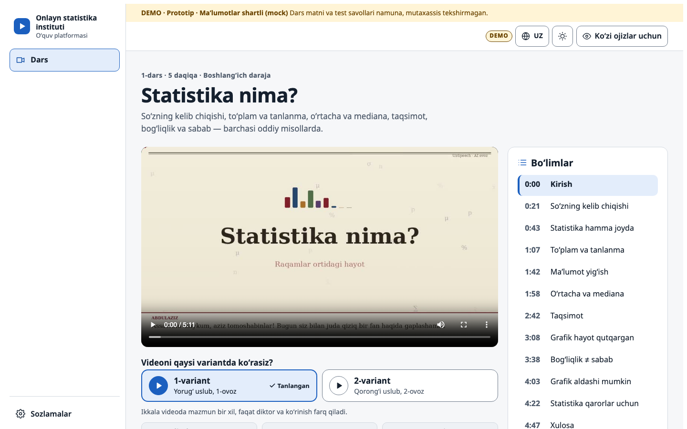
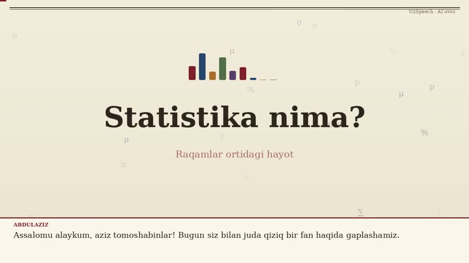
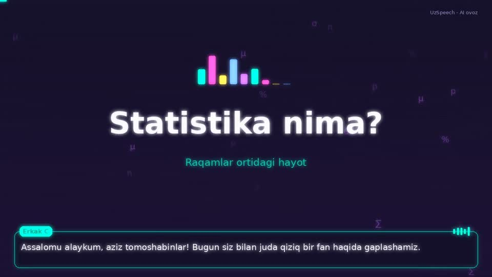
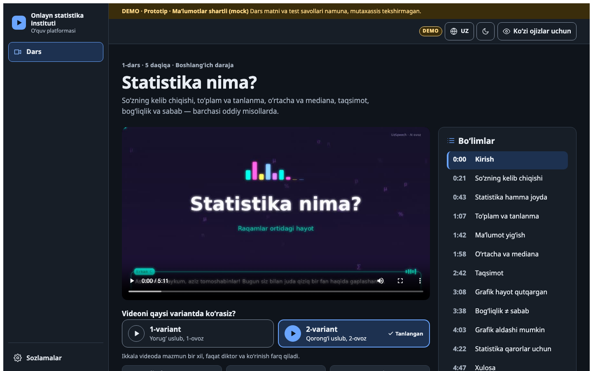
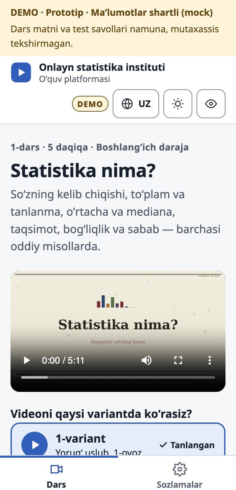

# Onlayn statistika instituti (DEMO)

Statistikani oddiy tilda oʻrgatadigan onlayn oʻquv platformasining namunasi (prototip).
Bitta dars tayyor: **«Statistika nima?»**, 5 daqiqa, ikki xil variantdagi video bilan.

> **DEMO · Prototip.** Dars matni va test savollari namuna, mutaxassis tekshirmagan. Rasmiy mahsulot emas.



## Videolar

Dars bitta, video ikki xil usulda va ikki xil ovozda. Mazmuni bir xil.

GitHub bunday katta videoni oʻz sahifasida koʻrsatmaydi: rasm yoki havolani bossangiz, video fayli yuklab olinadi. Videoni platformaning oʻzida koʻrish uchun pastdagi «Ishga tushirish» boʻlimiga qarang.

| 1-variant: yorugʻ uslub, 1-ovoz | 2-variant: qorongʻi uslub, 2-ovoz |
|---|---|
| [](media/statistika-nima-yorugh.mp4?raw=true) | [](media/statistika-nima-qorongi.mp4?raw=true) |
| [statistika-nima-yorugh.mp4](media/statistika-nima-yorugh.mp4?raw=true) · 5:11 · 7,5 MB | [statistika-nima-qorongi.mp4](media/statistika-nima-qorongi.mp4?raw=true) · 5:11 · 9,3 MB |

## Nimalar bor

- **Video markazda.** Sahifa ochilishi bilan dars va katta video chiqadi.
- **Ikki variant.** Video ostidagi ikkita tugma bilan almashtiriladi, video oʻsha joyidan davom etadi.
- **12 ta boʻlim.** Boʻlim bosilsa, video oʻsha daqiqaga oʻtadi.
- **Test.** 5 ta savol, har biriga izoh va «videoning shu qismini koʻrish» havolasi.
- **Dars matni** 5 tilda: oʻzbekcha (lotin va kirill), qoraqalpoqcha, ruscha, inglizcha.
- **Sozlamalar:** til, yorugʻ / qorongʻi / yuqori kontrast mavzu, koʻzi ojizlar rejimi, yengil rejim (sekin internet uchun).
- Qayergacha koʻrilgani va test natijasi brauzerda saqlanadi. Kirish va roʻyxatdan oʻtish yoʻq.

| Qorongʻi mavzu, 2-variant | Telefon |
|---|---|
|  |  |

## Ishga tushirish

Faqat Python 3 kerak, hech narsa oʻrnatilmaydi. Repo papkasida:

```bash
python3 tools/serve.py 5178 .
```

Keyin brauzerda `http://localhost:5178/index.html` manzilini oching.

Oddiy `python3 -m http.server` bilan ham ochiladi, lekin videoda boshqa daqiqaga oʻtish ishlamaydi. Shuning uchun `serve.py` ishlatiladi.

## Papkalar

| Joy | Nima |
|---|---|
| `index.html` | Oʻquv platformasining kirish sahifasi |
| `src/edu/` | Platforma qobigʻi: menyu, yuqori panel, sozlamalar sahifasi |
| `src/core/learn.js`, `learn.css` | Dars: pleer, video variantlari, boʻlimlar, test, dars matni (5 tilda) |
| `src/core/` | Umumiy qism: tillar, mavzular, koʻzi ojizlar rejimi |
| `media/` | Ikkala video va ularning muqova rasmlari |
| `tools/serve.py` | Mahalliy server (videoda daqiqaga oʻtish ishlashi uchun) |

Texnologiya: React 18 va htm (yigʻish bosqichisiz), oddiy `<video>` elementi. Tashqi pleer, reklama yoki kuzatuv xizmatlari yoʻq.

## Holati va cheklovlar

- Bu namoyish uchun prototip. Server qismi yoʻq, maʼlumot faqat brauzerda saqlanadi.
- Dars matni videodagi yozuvlardan olingan, ayrim qisqa jumlalar tushib qolgan boʻlishi mumkin.
- Test savollarini mutaxassis tekshirmagan.
- Qoraqalpoqcha va oʻzbekcha (kirill) tarjimalarni ona tilida soʻzlashuvchi koʻrib chiqishi kerak.
- `src/core/` kattaroq prototipdan olingan umumiy kod. Undagi `data.js` faylidagi raqamlar shartli (mock), rasmiy statistika emas, va bu platformada koʻrsatilmaydi.
- Haqiqiy telefonlarda va ekran oʻquvchi dastur bilan hali sinalmagan.
